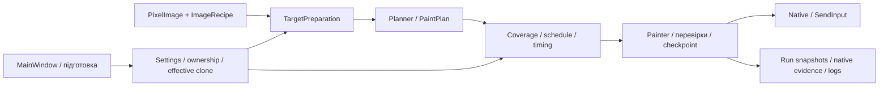

# Pixora — карта архітектури

Перевірено за локальним кодом 21.10.2026. Це карта реалізованих залежностей; поточна готовність — у [PROJECT_STATE.md](PROJECT_STATE.md). Розширений історичний опис: [ARCHITECTURE_UA.md](ARCHITECTURE_UA.md).

## Межі проєктів

`CanvasForge.Core` — .NET 8, моделі та алгоритми без WPF і native-вводу. `CanvasForge.App` — .NET 8 Windows/WPF, залежить від Core та SkiaSharp, містить UI, захоплення, координацію й транспорт. Два console test hosts перевіряють Core і WPF; PowerShell fixtures — сценарії запуску. Публічна назва продукту — Pixora; внутрішні імена не перейменовувати без потреби.

## Модулі, які читати перед зміною

| Область | Джерело | Залежності та контракт |
| --- | --- | --- |
| Параметри та володіння | [Models.cs](src/CanvasForge.Core/Models.cs), [SettingsStore.cs](src/CanvasForge.Core/SettingsStore.cs), [ConfigOwnership.cs](src/CanvasForge.Core/ConfigOwnership.cs) | Знімки settings, path/revision/SHA, compare-and-save під lease. Застаріла копія не перезаписує свіжий стан. |
| Ціль зображення | [TargetPreparation.cs](src/CanvasForge.Core/TargetPreparation.cs), [ImageProcessing.cs](src/CanvasForge.Core/ImageProcessing.cs), [Planner.cs](src/CanvasForge.Core/Planner.cs) | ImageRecipe фіксує обробку/квантування/alpha/edge merge окремо від вводу. Зміна speed або execution route не повинна тихо стирати деталі target. |
| Політика режимів | [ReleaseProfile.cs](src/CanvasForge.Core/ReleaseProfile.cs), [DrawingWorkflow.cs](src/CanvasForge.Core/DrawingWorkflow.cs) | Standard застосовує робочий clone; експериментальні налаштування не стираються. Adaptive має окремі вимоги доказу. |
| Виміряні пензлі | [MeasuredColorPlan.cs](src/CanvasForge.Core/MeasuredColorPlan.cs), BrushFootprints / BrushMotionEvidence | Possible, Solid і профілі руху розділені. Сумісність геометрії, mapping, емітера й таймінгів входить у придатність профілю. |
| Доказ редактора | [CanvasStructure.cs](src/CanvasForge.Core/CanvasStructure.cs), CanvasPatchSelector / EditorEvidence / BrushToolState | 16 ROI поза controls, строгий runtime rect; tool guard окремий від геометрії. Підготовка не означає сертифікації сліду. |
| Ввід і відновлення | [Painter.cs](src/CanvasForge.App/Painter.cs), [Painter.EditorEvidence.cs](src/CanvasForge.App/Painter.EditorEvidence.cs), [Native.cs](src/CanvasForge.App/Native.cs) | Фокус/PID/DPI/координати/tool/color перевіряються до paint-down; помилка читання курсора зупиняє ввід. Release потрібен і на помилці. |
| Standard motion | [StandardStrokeMotion.cs](src/CanvasForge.Core/StandardStrokeMotion.cs) | Щільний шлях і пакетування розділені. StandardLineMotion / StandardContourMotion — окремі маршрути з власним контекстом; прототип не стає default через офлайн-PASS. |
| Фізичні прототипи | [StandardBandResponse.cs](src/CanvasForge.Core/StandardBandResponse.cs), [StandardDiscreteBand.cs](src/CanvasForge.Core/StandardDiscreteBand.cs) | Модель повної історії нанесення. Невідома комбінація лишається unavailable; відсутнє фізичне підтвердження не замінюється вигаданою маскою. |
| Геометричні метрики | [StandardPhysicalQuality.cs](src/CanvasForge.Core/StandardPhysicalQuality.cs), [контракт](docs/quality/PHYSICAL_QUALITY_CONTRACT.md) | Pure v3: immutable factory results; абсолютні краї, pooled/row P95, розмах/ширина/сходинки та L∞ caps із sampling bound. `CompareLineMetric` вимагає Complete, provenance/context і сумісну per-metric U; hash метаданих не замінює доказів. Caps decision заблокований до provenance/U; умовні sup-bound фактори 1/2/4 не оцінюють e. Без capture/fitting/dispatch/default-допусків; результати не сертифікують фізичну якість. |
| Raw requested-color mask | [StandardPaintMask.cs](src/CanvasForge.Core/StandardPaintMask.cs), [StandardBandResponseReview.cs](src/CanvasForge.App/StandardBandResponseReview.cs) | Незмінний snapshot raw RGB12 + contrast>80; requested color з frozen stage, не observed median. Missing/disconnected/clipped не мають edge. Physical boundaries index−0.5. Окрема діагностика у чинному offline review; без START/dispatch/Solid. |
| Явний збір | [FrontierSessionCapture.cs](src/CanvasForge.App/FrontierSessionCapture.cs), [Painter.EvidenceSeries.cs](src/CanvasForge.App/Painter.EvidenceSeries.cs), [StandardDiscreteBandCli.cs](src/CanvasForge.App/StandardDiscreteBandCli.cs) | Ізольований CLI, frozen inputs, одноразові спроби, прив'язка до бінарників і сесії. Звичайний START окремий. |
| UV-дослід B | [StandardUvPilot.cs](src/CanvasForge.App/StandardUvPilot.cs), [StandardUvAnalysis.cs](src/CanvasForge.App/StandardUvAnalysis.cs) |12 frozen paths/3 reservations, per-stroke pairs через чинний runner. Fresh capture через спільний Frontier Binding; старі Pair wrappers збережено. Суворий context/protocol/assets/no-retry;24 edge reports S/counts/signs/events. C3′ механізму окремо від practical C3 та production quality. Наявний contour entry, без нового START/default або phase-коректора. |
| Робоча UV-модель після пілота | [UV_RESPONSE_MODEL.md](docs/quality/UV_RESPONSE_MODEL.md) | Design draft, не новий runtime: розділені input/emitter/render/observable і low/high/width. Паперовий proxy не є inverse mapping; adjacent jump counts не охоплюють розподілені переходи. Старий frozen analysis не змінено, production-fit відсутній. |
| Прогноз спостереження двох країв | [StandardStrokeObservation.cs](src/CanvasForge.Core/StandardStrokeObservation.cs) | Pure Core hypothesis: задані геометричні low/high → coverage → явний along-kernel → чинний local50. Immutable path/context/history/geometry/before binding, body/caps і missing support. Compare повних меж/width/center/RMS без фізичного PASS, U або dispatch; I/E/T не fitted. Звичайний START/налаштування незмінні. |
| Експериментальна тексельна адресація | [StandardTexelColumnHypothesis.cs](src/CanvasForge.Core/StandardTexelColumnHypothesis.cs) | Явні fitted coefficients/provenance/context/domain → integer column і centered vertical candidate з round-to-even/margin. Pure Core, без default511.05/β, fit/search/Native/START; geometry-dependent effective period не дорівнює встановленому texture resolution. Не qualifying profile, dispatch/production=false. Невідомий контекст/domain або недостатній margin відхиляються. |
| Дослідницька спільна 2D-адресація | [StandardTexelPlaneHypothesis.cs](src/CanvasForge.Core/StandardTexelPlaneHypothesis.cs), [межі](docs/quality/TEXEL_2D_RESEARCH_CANDIDATE_V1.md) | RowV2 + чинний column hypothesis: спочатку цілийY, потімX на цьомуY; явний matching prediction-context/provenance, common-domain intersection, обидва indices/margins. Окремі immutable cell-center paths і dense H/V: кожен screen-along pixel, сталий поперечний індекс/margin; along-axis address змінюється навмисно. V рахує формулу на кожному ціломуY, без endpoint interpolation. Pure Core без fit/Native/settings/START, footprint/Solid/overlap або фізичного2DPASS. |
| Runnable тест тексельних вертикалей | [StandardTexelPilot.cs](src/CanvasForge.App/StandardTexelPilot.cs), [StandardTexelView.cs](src/CanvasForge.App/StandardTexelView.cs), [StandardTexelAnalysis.cs](src/CanvasForge.App/StandardTexelAnalysis.cs) | Власний manifest/10paths/5groups і forecast; існуючі contour entry/runner/guards, fresh protocol/PID/DPI proof,1962native support neighborhoods + zero-displacement unique side registration (v2), argmax diagnostic only. Per-stroke pairs,8210mandatorybody rows, caps окремо, two-edge events та one-to-one control precision/recall. Offline commands перед Native lease. Explicit diagnostic only, без нового START/target/schema/default чи quality eligibility. |
| Runnable2D research | [StandardPlanePilot.cs](src/CanvasForge.App/StandardPlanePilot.cs), [StandardPlaneAnalysis.cs](src/CanvasForge.App/StandardPlaneAnalysis.cs), [контракт](docs/quality/TEXEL_2D_PILOT_V1.md) |13cases/28released tracks; pureCore dense H/V, fixed row/column parameters, exact context/disjoint reservations/hash-bound assets. Thin Painter adapter uses existing contour runner/per-track verifier/fresh session.3466mandatory line sections, signed absolute phase020 one-to-one control matching, complete-data gate. Position/block diagnostic, no Solid/B/physicalPASS or ordinary START. Offline entry before Native lease; retained launcher review-only. |
| Візуальний ввід Size | [VisualSizeEntry.cs](src/CanvasForge.App/VisualSizeEntry.cs), Painter.Slider/SliderMatches | Два current visual frames без clipboard; правильний Size без edit, інший — guarded numeric Unicode keys та післяввідна перевірка. Numeric/HEX clipboard path і preservation незмінні. Row CLI має console result/exception без modal result; launcher читає runner та startup status forms. |
| Час і діагностика | [RunTimeBreakdown.cs](src/CanvasForge.Core/RunTimeBreakdown.cs), Painter snapshots / DiagnosticBundle | Виключні фази підсумовуються до Wall; вкладені витрати не додавати вдруге. Відправлені команди ≠ перевірений малюнок. |
| Горизонтальна вісь B | [StandardRowPilot.cs](src/CanvasForge.App/StandardRowPilot.cs), [current baseline policy](docs/quality/ROW_AXIS_CHARACTERIZATION_V2.md) | 12 звичайних H-проходів через чинний contour runner; 8 training +4 held-out, fresh view/baseline/protocol/binary bindings. Review вимірює лише training; цілісність усіх12 пар обов’язкова. Без переносу вертикальних коефіцієнтів, fit/inverse/START/settings змін; current fullCanvasRGB12 reference лише з явної цієїсесіїCaptureFresh; archivedgeometry окремо. Retained launcher лише review/originalReason. Це characterization, не B0 або quality qualification. |

Новий [row-offgrid v1b](docs/quality/ROW_OFFGRID_PILOT_V1B.md) використовує [TexelResearch.cs](src/CanvasForge.Core/TexelResearch.cs): параметризовані TexelGrid/Target/Planner з explicit experimental gate, finite-family row consensus, окремим observation-span2 і provenance/context. Нові [manifest](src/CanvasForge.App/StandardRowOffgridPilot.cs)/[analysis](src/CanvasForge.App/StandardRowOffgridAnalysis.cs) генерують ті самі frozen37траси через Coreinverse та використовують чинний contour runner через thin Painteradapter. Повнота1123перерізів до арифметики; симетричнаmedian(abs) для кандидата/rivals, cumulative-prefix/frame/tracebinding. Логічний target/план не є Solid/width/overlap/colour моделлю; ordinarySTART не інтегрований, усі eligibilityfalse. СтарийPlane1/rowV2-код збережений як historical frozen протокол; він не стає чинним масштабом через наявність класу.

MainWindow і Painter мають багато partial-файлів зі спільним станом. Partial-файл сам собою не є незалежним сервісом. Перед зміною простежувати виклики, cancellation, owner settings і побічні ефекти; не починати загальне переписування цих класів без доведеної потреби.

## Координати та незмінні обмеження

- Planner працює в цільовій сітці; команди — у фізичних екранних px. Client-local = screen − client origin; native screenshot індексується від його screen rect. SendInput має окрему нормалізацію абсолютних координат. Не додавати уявні DPI-множники.
- Rebase вікна та емпірична компенсація фарби — різні операції. Підтверджений user-selected rect зберігати точно, включно з дозволеним запасом рамки; no-go controls і межі дозволеного вводу лишаються обов'язковими.
- Runtime structural proof: 16 ROI, correlation 0.985, допустимий зсув 0 px. Відмова не навчає новий reference. Новий reference створюється тільки явною підготовкою, з одним source frame для rect і структури.
- RGB12 та contrast80 стосуються контрактів фарби; діагностичні half-intensity edges не є їх заміною. Пороги/кількість ROI не послаблювати задля PASS.
- Команда, системний cursor reading, preview, Possible і гарантоване Solid — різні спостережувані величини. Збіг cursor readings не сертифікує фізичну межу.
- Жодних DLL-ін'єкцій, читання пам'яті гри чи обходів захисту. Транспорт — штатний ввід Windows.

## Перед великою зміною

Записати у задачі: причину → зачеплені модулі/читачі стану → сумісність settings/checkpoint/profile → ризики й відкат → конкретні перевірки. Достатньо короткого запису та посилань; окреме велике ТЗ для кожного патча не потрібне. Тести вибирати з [TEST_MATRIX.md](TEST_MATRIX.md), результати зберігати у [PROJECT_STATE.md](PROJECT_STATE.md).
