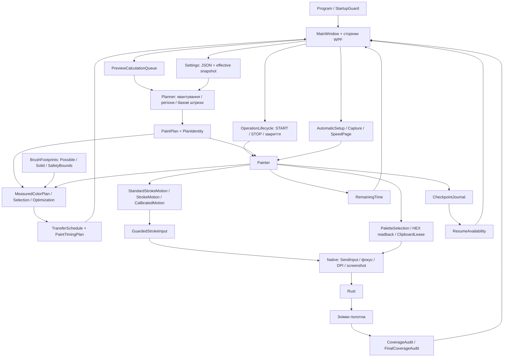
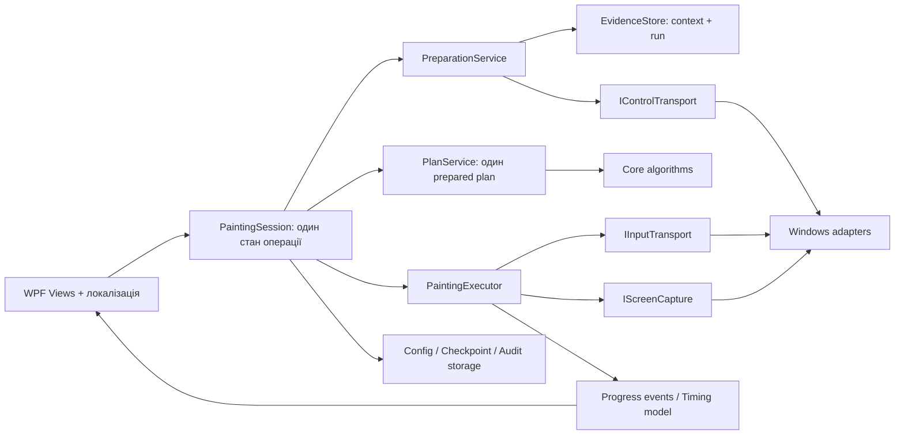

# Архітектура Pixora: поточний стан і захист від регресій

Дата перевірки: 2026-10-11. Поточний локальний стан: beta.59 на основі beta.58 та виправлень за попереднім живим тестом.
Це опис прочитаного коду. Пропоновані модулі в останньому розділі ще не є реалізованою перебудовою.

## Висновок

Ядро вже має корисне розділення алгоритмів, моделей пензля та транспорту вводу.
Проте застосунок ще не має чітко відокремленого шару керування операціями:
`MainWindow` одночасно будує інтерфейс, змінює конфігурацію, запускає перевірки,
керує задачами, читає checkpoint і показує результати аудиту.
`Painter` одночасно керує фокусом, кольорами, clipboard, контролами,
штрихами, прогресом, checkpoint та аудитом.

Це не означає, що кожне оновлення неминуче ламає продукт. Але знайдені збої
показують конкретну небезпеку: локальна зміна одного сценарію має приховані
наслідки для іншого. Розбиття класу на partial-файли полегшує навігацію,
але не прибирає спільний змінний стан і залежності між сценаріями.

## Поточна схема

Напрямок залежностей між проєктами правильний: WPF App посилається на Core;
Core не посилається на WPF, Windows API або Rust. `ICalibratedStrokeInput`
дозволяє перевіряти протокол руху симуляцією без вводу у гру.

У перевіреному дереві приблизно 6 тис. рядків у 55 C# файлах Core та
7,7 тис. рядків у 50 C# файлах App. Головні файли `MainWindow.cs` і `Painter.cs`
мають понад тисячу рядків кожен; значна частина їхніх обов'язків також живе
в інших partial-файлах. Кількість файлів сама по собі не є оцінкою якості.

## Відповідальність модулів

| Частина | Основні файли | Що робить / межі доказу |
|---|---|---|
| Конфігурація | `Core/Models.cs`, `DrawingWorkflow.cs` | JSON, валідація, snapshot; багато строкових ключів без перевірки компілятором |
| Кольори та план | `Planner.cs`, `EdgeRegionMerge.cs`, `PaletteComparison.cs` | Цільове зображення та кількість кольорів; зміна цілі має бути видима користувачу |
| Модель пензля | `BrushFootprints.cs`, `BrushCalibrationBatch.cs`, `BrushLocalColor.cs` | Виміряні маски від координати команди; Possible не дорівнює Solid |
| Комбіноване планування | `MeasuredColorPlan.cs`, `MeasuredPlanSelection.cs`, `MeasuredStrokeOptimization.cs` | Безпечні центри, вибір за модельною вартістю, видалення повторних гарантованих ділянок |
| Розклад та ввід | `TransferSchedule.cs`, три класи Motion, `Painter.cs` | Розклад команд і транспорт; завершені команди не доводять фізичне покриття |
| Простір і швидкість | `ProbeSpatialCalibration.cs`, `SpeedCalibration.cs`, `ProbeAnalysis.cs` | Профілі прив'язані до контексту; коротка перевірена лінія не доводить довгу |
| Аудит | `CoverageAudit.cs`, `FinalCoverageAudit.cs`, `Painter.FinalAudit.cs` | Порівняння кадрів; Unknown не є Missing або ціллю ремонту |
| Продовження | `ResumeCheckpoint.cs`, `ResumeAvailability.cs` | Checkpoint з наступною операцією, identity і кількості груп |
| Прогрес | `RemainingTime.cs`, `Painter.Timing.cs`, `TimingProgress.cs` | Фактичний темп після накопичення зразків; рання оцінка непевна |
| Інтерфейс | `MainWindow.cs` та сторінки | Презентація, readiness, локалізація; зараз також orchestration і storage |
| Windows | `Native.cs`, `Native.Clipboard.cs`, `ClipboardLease.cs`, `Images.cs` | Побічні ефекти; найважче відтворювана частина офлайн |

## Як проходить одна операція

1. Відкриття зображення створює source. Зміни конфігурації скасовують застарілий preview.
2. Захоплення та калібрування створюють evidence, прив'язаний до геометрії, DPI,
   режиму кольорів, форми та Size. Наявність запису в JSON сама по собі не означає Ready.
3. Planner створює PaintPlan. MeasuredColorPlan використовує актуальні маски
   і окремо повертає UnplannedPixels.
4. Preview публікує результат тільки для актуальної generation та готує groupCounts
   для ResumeAvailability. START повторно будує розклад у worker.
5. Painter перевіряє фокус/геометрію, застосовує контролі й кольори, виконує штрихи.
   Після завершеної операції оновлює checkpoint у пам'яті та вимірює час.
   Journal атомарно записує файл на межах груп, зупинці/паузі та періодично
   після 50 операцій; це не запис на диск після кожного штриха.
6. Фінальний аудит використовує початковий кадр саме поточного запуску.
   UI окремо показує завершення команд і підтвердження покриття.

## Чому виникали регресії

| Межа | Відтворена проблема | Виправлення / що ще потрібно |
|---|---|---|
| STOP → preview → RESUME | Спільний CancelActiveWork стирав опублікований schedule активного painting | STOP worker зберігає schedule; STOP незавершеного preview його скасовує; окремі тести |
| Readback → screenshot | Parking одного поля переносив курсор на сусідній Interval | Один ControlCapture для області всіх контролів перед кожним ReadSlider і locator |
| Size → active colour proof | Залишений Size 2 робив preview замалим для медіани і блокував наступні Size | Known readable Size перед вибором; strict proof на readable Size з поверненням requested Size до штампа |
| Calibration → ordinary Draw | Початок звичайного штриха використовував SetCursorPos, калібрування — SendInput | StandardStrokeMotion через той самий guarded adapter; timing і pitch збережено |
| Fresh START → RESUME → audit | Baseline попереднього запуску того самого плану міг стати поточним після перерваного countdown | Старий baseline видаляється до нового checkpoint; відсутній кадр лишає Unknown |
| Manual calibration → stepper | Ручна перевірка була Ready, рядок майстра лишався Pending | Optional рядки використовують актуальний proof, не лише історію майстра |
| Новий план → старий audit | Rebuild повертав старі відсотки як поточний результат | Поточний прогрес скидається; попередній аудит явно позначений історичним |
| Timing model → runtime | Витрати SendInput до перших зразків не враховані; текст «до» виглядав як гарантія | Прибрана непідтверджена верхня межа з раннього UI; модель початкового часу ще потребує розвитку |

## Що вже захищає від поломок

- Core не виконує Windows input; алгоритми і протоколи перевіряються окремо.
- CancellationToken, одна preview-черга і generation не допускають публікацію старого результату.
- PlanIdentity та calibration context відкидають прогрес/докази, які не відповідають плану.
- CheckpointJournal записує завершені операції через тимчасовий файл і rename.
- Guarded input перевіряє фокус, DPI, геометрію і скасування; mouse/key release відбувається при помилці.
- Палітра, numeric readback та pixel evidence не повинні підміняти один одного.
- Unknown, відсутній baseline і незавершений аудит не перетворюються на успіх.

## Що ще не можна назвати доведеним

Попередній живий тест дав приблизно 88–90% підтвердженого покриття маленьких
кольорових блоків. Офлайн-прохід не виправляє цей результат заднім числом.
Модель крапки не доводить суцільний слід довгого або зворотного руху, його
початок/кінець і поведінку на іншому FPS. Потрібен повторний живий тест нової збірки.

Не доведено також, що Adaptive завжди швидший. Порівнювати потрібно той самий
target, маски, coverage, таймінги й пристрій. Різна кількість штрихів сама по собі
не доводить прискорення. Треба враховувати зміну Size/форми, межу довжини
підтверджених маршрутів, рух та повторні ділянки.

## Цільова архітектура: наступні зміни поетапно

Не переписувати весь UI одним релізом. Безпечний порядок:

1. Винести cancellation та переходи Idle/Preparing/Checking/Drawing/Paused/Stopped/Completed
   у PaintingSession. Розділити дію STOP від invalidation конфігурації.
2. Створити immutable PreparedPaintRun: source/target identity, settings snapshot,
   measured plan, schedule і timing. Передавати один об'єкт у preview та executor,
   щоб не будувати два потенційно різні розклади.
3. Винести controls/clipboard/screenshots за інтерфейси, як уже зроблено для motion.
   Fake adapter повинен відтворювати cursor contamination, marker-only clipboard,
   delayed frame і втрату фокуса, а не лише позитивний сценарій.
4. Ввести явний RunId для checkpoint, baseline, audit і progress; перенести файли
   діагностики у каталог запуску. Наразі мінімальний захист baseline реалізований,
   але повний RunId ще не введений.
5. Замінювати строкові settings типізованими групами по одному домену,
   з міграцією JSON і збереженням невідомих ключів.

Кожний крок — окремий невеликий diff із regression-перевіркою переходів і
міграції. Переміщення файлів або збільшення кількості тестів не замінює живої
перевірки pixel output.

## Мінімальний набір перед релізом

Release build без warnings/errors; Core і WPF headless; старі конфігурації;
STOP активного worker і pending preview; START/RESUME identity; fresh baseline;
palette/HEX source proof; кілька Size; 7 мов і DPI matrix; живий тест чистих
блоків, країв H/V/reverse, Adaptive проти ordinary за однакового target;
фінальний audit та ранній/виміряний ETA. Офлайн і in-game результати зберігати окремо.
