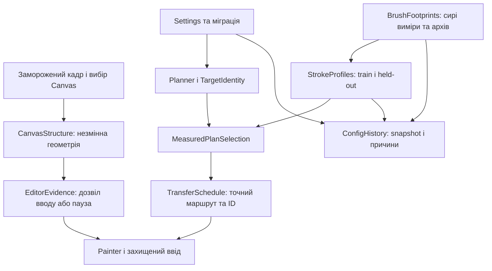

# Pixora RC6: реалізація та межі перевірки

Дата: 15.10.2026. Збірка: **1.0.14-rc.6+local-rc6-structure**. Це локальний release candidate з робочої копії, а не коміт GitHub. Точний склад джерел і DLL зафіксований SHA256 у `Pixora_RC6_Validation_Receipt.json`.

Реалізовано структурну перевірку захопленого Canvas, однакову ціль між режимами, історію збережень конфігурації та окрему модель виміряного рухомого штриха для Adaptive. **Pixora.exe і ввід у Rust не запускалися.** Коректність нового детектора й фізична якість нових штрихів у Rust ще не підтверджені.

## 1. Рамка, геометрія та пауза

Старі 16 кольорових точок рамки могли одночасно хибно пропускати іншу текстуру в TL і блокувати незмінний редактор у TR. Відповідність 13/16 не була доказом правильної геометрії. Тому її більше не використано як дозвіл чи заборону вводу. Розрахунок 15/16 залишено в діагностиці для порівняння з RC5. Це **заміна джерела доказу**, а не зниження порога до 13/16.

Новий `CanvasStructure` зберігає 16 зовнішніх текстурних ділянок: 12 смуг уздовж сторін та 4 кутові ділянки. Вони віддалені від вибраного полотна щонайменше на консервативний запас 18 фізичних пікселів для звичайного Size 3, щоб власний крайовий слід не руйнував еталон. Для захоплення потрібна видима навколишня рамка; занадто тісне кадрування чи недостатня структура відхиляються з поясненням.

Прямокутник Canvas, структурні RGB-патчі, DPI, розмір клієнтської області й SHA256 кадру походять з **того самого замороженого знімка**, на якому користувач підтверджує область. Невдалий кандидат не публікується замість поточних налаштувань.

Перед вводом перевіряються:

- точна рівність вибраного `rect`, DPI та розміру клієнтської області еталону;
- нормалізована кореляція текстури кожного патча й зміна нормалізованого кольору;
- однозначність збігу на сітці зсувів ±3 px; **допустимий зсув — тільки (0, 0)**.

Пошукове вікно локатора не пересуває Canvas і координати вводу. Ненульовий найкращий зсув, неоднозначність або відсутній еталон дають Missing. Поточні структурні пороги: кореляція 0.985, відрив максимуму 0.001, зміна нормалізованих каналів 0.05. Це параметри нового доказу редактора; вони не замінюють paint contrast 80 або RGB tolerance 12.

Старі еталони RC5 не підвищуються автоматично до нового формату. **Після переходу треба повторно захопити Canvas.** Під час runtime-паузи заголовок показує паузу й причину; під час активного вводу — виконання, замість зеленого «Усе готово».

До відмови додаються фактичні й еталонні патчі з околицями ±3 px. Це дає матеріал для незалежного replay. Старі 36 кадрів без парного структурного еталона залишаються негативним історичним матеріалом; вони не сертифікують Present нового детектора.

Обмеження: це реєстрація текстури конкретної сесії, а не універсальний розпізнавач дерева чи фізичної сутності полотна. Тіні, перекриття або слабка текстура можуть викликати консервативну паузу. Поведінка на нових парних native-кадрах потребує живого тесту.

## 2. Однакова ціль у Standard та Experimental

`edge_merge` тепер OFF у словнику дефолтів і при міграції старих конфігів без явної нової політики згоди. Саме перемикання режиму не вмикає й не вимикає об'єднання деталей. Новий явний ON зберігається і при переході до Standard.

Якщо користувач увімкнув ON і зміни справді є, основна сторінка до START показує кількість змінених клітин, відсоток і кількість регіонів. Повідомлення видно й при згорнутих розширених налаштуваннях.

Додано окремий `TargetIdentity`: розміри цілі, RGBA/alpha, індекси й RGB палітри. Він відрізняється від `PlanIdentity`, який включає спосіб виконання та потрібний для checkpoint. Однакова ціль не означає взаємозамінний checkpoint різних маршрутів.

Офлайн-replay на оригінальному Cowboy 1042×1042 і збереженому конфігу RC5 з **точною RC6 Core DLL**:

| Варіант | Ціль | Використаних кольорів | Штрихів базового плану | TargetIdentity |
| --- | --- | ---: | ---: | --- |
| Standard, merge OFF | 324×321 | 56 | 10862 | `78DFA270…91DAE1E` |
| Experimental, merge OFF | 324×321 | 56 | 10862 | `78DFA270…91DAE1E` |
| Experimental, явний merge ON | 324×321 | 16 | 2187 | `4E5094B0…050626` |

У двох OFF-випадках RGBA, індекси та RGB палітри ідентичні. Явний ON змінює 9540/104004 = 9.1727% клітин. Це доказ ізоляції обробки цілі; він не є порівнянням якості фактичного малювання в Rust. В окремому тесті перевірено й збереження явного ON після застосування Standard.

## 3. Маски й історія конфігурації

Розділено збережений сирий профіль, поточну придатність і архів. Застаріла геометрія чи невдала повторна проба більше не означає безслідне видалення вимірів. Непридатний старий PASS не залишається активним дозволом на малювання.

Усі штатні збереження проходять через `ConfigHistory`:

- спільне блокування за повним шляхом, унікальний тимчасовий файл, атомарна заміна;
- SHA256-знімок конфігу після кожного успішного запису; однаковий вміст зберігається один раз;
- збереження точних попередніх байтів, включно з BOM, перед першою заміною;
- запис `saveId`, джерела, версії стану, SHA, активних і архівних ID/Size/Shape/Context, мутацій і причин;
- якщо застарілий кандидат пропустив уже збережений профіль, його сирі виміри повертаються в архів із причиною `save_preserved_missing_profiles`;
- діагностичний ZIP включає `config-history/`.

Повний lifecycle-тест перевіряє повторне вимірювання, інвалідацію, збереження, пропуск профілів застарілою копією, архівацію й дедуплікацію. Він перевіряє новий захист. **Точну історичну причину зникнення 5/7/15/20 у RC5 не встановлено**, і втрачені сирі маски не відновлено припущеннями зі знімків.

Історія має дедуплікацію, але поки не має політики видалення унікальних знімків. Під час тривалого тестування вона може зростати. Гарантія збереження стосується валідних серіалізованих профілів; пошкоджені файли не перетворюються на активний дозвіл.

## 4. Adaptive: вимір реального штриха

Великі пензлі більше не допускаються до production-маршруту тільки за старим swept-dot proof. Старі докази архівуються, включно з конфігами після повернення на RC5. Внутрішній прапорець у конфігу не може відключити обов'язковість нової перевірки для реального Painter.

Початкова модель RC6 навмисно обмежена: **прямий штрих H або V довжиною рівно 32 фізичні пікселі**, вперед, Stable/Rapid із записаним таймінгом кадру, мінімум 20 мс. Довжини, реверс, діагоналі й інші швидкості цим профілем не сертифіковані.

Для кожного Size/напрямку:

1. Перевіряється джерело активного кольору; неправильна фарба не є успішною пробою.
2. Ролі задаються наперед: дві позиції для навчання, третя незалежна для валідації. Фізичний порядок перемішується із записаним seed, щоб не ототожнювати час і позицію.
3. У кожній позиції виконуються три нанесення. Зберігаються фонові та проміжні PNG, координати команд, роль, порядок, контекст і причина відмови.
4. `Possible` — об'єднання повних слідів двох навчальних штрихів, `Solid` — їхній raw command-relative перетин. Зсуви не підганяються до центру плями.
5. Незалежний штрих має залишитися всередині навченого Possible, містити очікуване ядро й відповідати кольору. Валідація не розширює навчену маску.
6. Зміна ядра при повторному нанесенні понад RGB 12, зайвий слід, інший напрямок чи неправильне джерело відхиляються. Негатив Size 10 з delta 18/12 лишається FAIL.

Окремо реалізовано діагностичні експозиції Size 3: 0/64/128 мс на незалежних ділянках у перемішаному порядку. Це не висновок про кількість stamp і не дозвіл на профіль.

Планувальник розміщує **всю виміряну маску рухомого штриха** тільки в одноколірній області й у межах полотна. У покриття зараховується Solid. Звичайний малий пензель заповнює залишок; зайві команди без нових підтверджених пікселів прибираються. Великі команди не об'єднуються й не перевертаються. ID профілю, розмір, форма, довжина та напрямок перевіряються й перед виконанням.

Є порівняння з базовим маршрутом на тій самій цілі: великий кандидат обирається лише без втрати модельного покриття й при меншій розрахунковій вартості. Інакше показується базовий маршрут. Виграш у синтетичному тесті не є доведеною економією в грі.

Обмеження й наступний тест:

- **Жоден новий native stroke-profile RC6 ще не отримано.** Наявність реалізації не означає, що всі 2/3/5/7/10/15/20 пройдуть.
- Контрольний малий residual-пензель зберігає попередню модель; його фізична точність біля країв теж потребує огляду.
- Три позиції не доводять стабільність на всьому полотні, усіх кольорах і при іншому освітленні. Протокол потрібно розширювати за новими парними даними.
- Чистого місця для всіх незалежних великих проб може не вистачити. Проби йдуть від великих розмірів; доступне окреме повторне калібрування. Необов'язкова відмова не блокує Standard.
- Неповторюваний фізичний слід не виправляється зниженням contrast 80 / RGB 12 або примусовим зеленим статусом.

## 5. Інтерфейс, сумісність і пакет

Залишено підтримувані Size **2, 3, 5, 7, 10, 15, 20**, Standard типовий. Вимір руху показує окремі підтверджені H/V, а не загальну обіцянку швидкості. Нові повідомлення та пояснення доступні сімома мовами: українською, англійською, польською, німецькою, французькою, іспанською й російською.

Interval 0.01 / Opacity 1.00 не захоплюються, не записуються й не перевіряються. Їх треба вручну виставити у Rust. Видалена галочка прибирання фону не повертається; alpha джерела збережена. Перевірка клітинки палітри й paint tolerance 12 не послаблювалися. Цей етап не змінює формулу ETA і не заявляє гарантованого прискорення Standard.

Схема конфігурації лишається v3 із новими політиками та архівами. Повторні міграції і rollback/повторний імпорт старих proof перевірені офлайн. RC5 execution-checkpoints не сумісні з новою версією розкладу; вони не видаляються. Новий START набуває свого checkpoint після першого paint input за чинною політикою.

Користувацький ZIP містить застосунок, runtime/DLL, ліцензії, коротку інструкцію та маніфест. Source, тести, історичні матеріали, логи й review лежать в окремому архіві для перевірки. Закріплений runtime 8.0.31 успадковано з попереднього пакета без оновлення залежностей. `System.Diagnostics.Tracing.dll` присутня.

## 6. Архітектура змін

Нові обов'язки винесено в окремі Core-модулі: `CanvasStructure`, `ConfigHistory`, `TargetIdentity`, `StrokeProfiles`, `StrokeProfilePlan`, `BrushExposureMotion`. WPF захоплює дані та показує стан. Великий MainWindow/Painter ще не пройшов повний рефакторинг; це окрема робота після стабілізації релізу.

## 7. Виконана перевірка

| Перевірка | Результат | Що вона доводить |
| --- | --- | --- |
| Release Core.Tests | 0 warnings / 0 errors | Компіляція поточних Core та тестів |
| Release App.Tests | 0 warnings / 0 errors | Компіляція WPF та headless-тестів |
| Framework Core | 566 PASS | Офлайн-контракти та регресії |
| Framework WPF | 201 PASS, включно з 84 DPI/layout | UI/headless-контракти |
| Ті самі Core/App тести з runtime майбутнього ZIP | 566 / 201 PASS | Поточні DLL із закріпленим runtime, без запуску Pixora.exe |
| Target replay exact RC6 Core DLL | OFF ідентичний між режимами | Усунення прихованого перетворення target |
| Живий Rust RC6 | **Не виконувався** | Немає сертифікації фізичної якості чи прискорення |

Додано 10 верхньорівневих Core-кейсів та один WPF-кейс; кількість кейсів не дорівнює кількості асертів. Негативи включають старий TL false PASS/TR FAIL, підміну текстури, перекриття, плоский кадр, змінені DPI/rect, фізичні зсуви 1–3 px, неправильний напрямок/довжину/таймінг штриха, held-out spill і delta 18/12.

Історичні тести не слід називати незміненими: асерти, що раніше авторизували рамку лише за 15/16 кольорів, тепер перевіряють цей розрахунок як діагностику. У старих lossy-video кейсах збережено перевірки HEX/палітри, але не заявляється структурна сертифікація. До окремих replay-fixtures додано зовнішні області з початкових історичних PNG; provenance записано окремо. Це похідні fixtures, не нові парні native-кадри.

Для відтворення у review-архіві є `TestHost/` із двома тестовими EXE, точними DLL/runtime та fixtures. Запускати `CanvasForge.Core.Tests.exe` і `CanvasForge.App.Tests.exe <каталог_скриншотів>` з TEMP/TMP у доступному для запису каталозі. TestHost не є користувацьким пакетом. Target replay має окремий C# harness і три явні сценарії; для повного повторення потрібний SDK .NET 8 та оригінальний вхід із Evidence.

## 8. Що перевірити користувачеві й рецензентам

Порядок живого тесту — в `TESTING_RC6_UA.md`. Спочатку нове захоплення та короткий Standard з палітрою, потім HEX, паузи/редактор, і лише потім один великий Adaptive Size на тому самому target. Потрібно передати повний експорт діагностики з парним reference/observed, config-history і moving-stroke PNG/JSON.

Незалежному рев'ю слід перевірити новий structural proof на позитивних **нових парних** даних та негативах; зіставити всі збереження ID; відтворити train/held-out без розширення Possible; порівняти фактичний target і повний виміряний слід команд. Старі 36 observed-кадрів не підходять як позитивний критерій Present.

Готовність цієї роботи: локальна збірка, офлайн-перевірка та пакет для живого тесту. Готовність продукту до загального релізу ще потребує задокументованого живого RC6-тесту. Коміт, push і публікація в Steam на цьому етапі не виконувалися.
